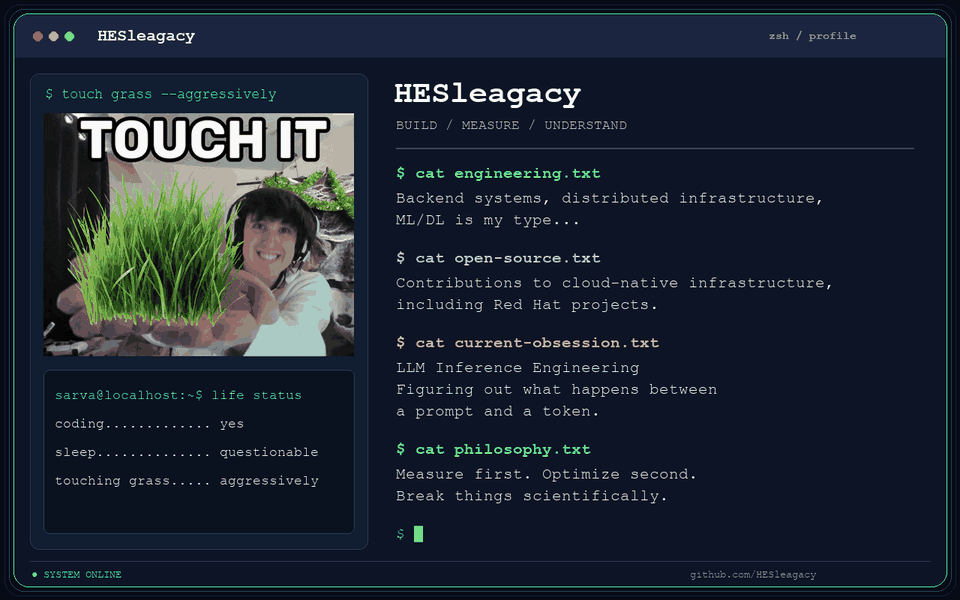

<!-- This repository must be named HESleagacy, exactly matching the GitHub username. -->

  <a href="https://www.linkedin.com/in/sarvadubey/">LinkedIn</a>
  &nbsp;·&nbsp;
  <a href="mailto:sarvadubey@gmail.com">Email</a>

<!-- Keep it intentionally minimal. Actual repositories demonstrate ability better than a wall of badges. -->
